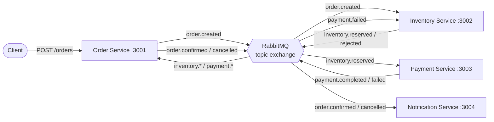

# Event-Driven Order Processing Platform

A distributed, event-driven order platform built from **four independently deployable microservices** that cooperate through a **RabbitMQ** message broker. Placing an order triggers a choreographed **saga** across the services, with compensating actions when a step fails.

The project exists to demonstrate the architecture, not the business domain: service boundaries, database-per-service, asynchronous messaging, idempotent consumers, dead-letter handling and saga compensation.



## Services

| Service | Port | Responsibility | Owns | Consumes | Publishes |
|---|---|---|---|---|---|
| **Order** | 3001 | Accepts orders, tracks order lifecycle | `orders` | `inventory.*`, `payment.*` | `order.created`, `order.confirmed`, `order.cancelled` |
| **Inventory** | 3002 | Product catalogue, stock reservation and release | `stock`, `reservations` | `order.created`, `payment.failed` | `inventory.reserved`, `inventory.rejected` |
| **Payment** | 3003 | Charges the customer (simulated gateway) | `payments` | `inventory.reserved` | `payment.completed`, `payment.failed` |
| **Notification** | 3004 | Tells the customer the final outcome | `notifications` | `order.confirmed`, `order.cancelled` | none |

## Tech stack

- **Node.js 22** and **Express 5** for each service
- **RabbitMQ 3.13** (topic exchange, durable queues, publisher confirms, dead-letter queues)
- **SQLite** (`node:sqlite`), one database file per service
- **Docker Compose** for local orchestration
- **Node's built-in test runner**, with an in-memory bus so the full saga is tested without a broker
- **GitHub Actions** for CI

## Quick start

Requires Docker.

```bash
docker compose up --build
```

Place an order that succeeds:

```bash
curl -s -X POST localhost:3001/orders -H 'content-type: application/json' \
  -d '{"customerId":"alice","items":[{"sku":"SKU-MOUSE","qty":2}]}'
```

Then check the outcome (use the `id` from the response):

```bash
curl -s localhost:3001/orders/<id>              # status: CONFIRMED
curl -s localhost:3002/products                 # stock decreased
curl -s localhost:3003/payments/<id>
curl -s "localhost:3004/notifications?customerId=alice"
```

Trigger the failure path (declined payment, so the stock is released):

```bash
curl -s -X POST localhost:3001/orders -H 'content-type: application/json' \
  -d '{"customerId":"declined-bob","items":[{"sku":"SKU-MONITOR","qty":1}]}'
```

The RabbitMQ management UI is at http://localhost:15672 (`guest` / `guest`).

## Running without Docker

Requires Node 22.13+ and a RabbitMQ instance.

```bash
npm install
npm test                         # full saga on the in-memory bus, no broker needed

RABBITMQ_URL=amqp://localhost PORT=3001 node services/order-service/src/index.js
```

## Repository layout

```
libs/common/            Shared building blocks: event envelope, RabbitMQ and in-memory bus,
                        idempotency helper, HTTP scaffolding, bootstrap
services/
  order-service/
  inventory-service/
  payment-service/
  notification-service/
docker/                 Parameterised Dockerfile used by all four services
docs/                   Architecture and design documentation
test/                   End-to-end saga tests
```

## Documentation

| Document | Contents |
|---|---|
| [Architecture](docs/architecture.md) | Context, containers, messaging topology, design principles |
| [Saga flows](docs/saga-flows.md) | Sequence diagrams for the success and failure paths, order state machine |
| [Event catalog](docs/events.md) | Envelope format, every event, routing and queue bindings |
| [Services](docs/services.md) | Per-service responsibilities, data models and rules |
| [API reference](docs/api.md) | HTTP endpoints of every service |
| [Reliability](docs/reliability.md) | Delivery guarantees, idempotency, dead letters, known trade-offs |
| [Development](docs/development.md) | Running, testing, configuration, adding a service |
| [Decision records](docs/decisions.md) | Why the key design choices were made |

## License

MIT
