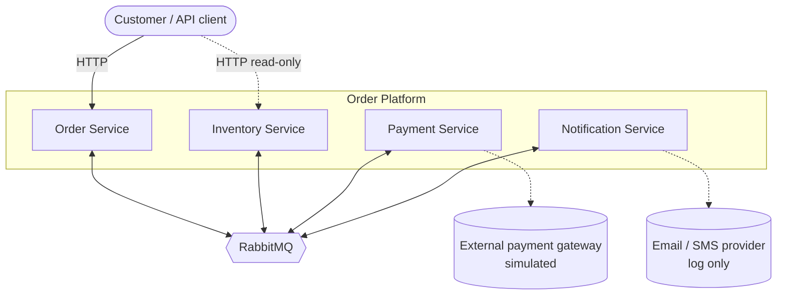
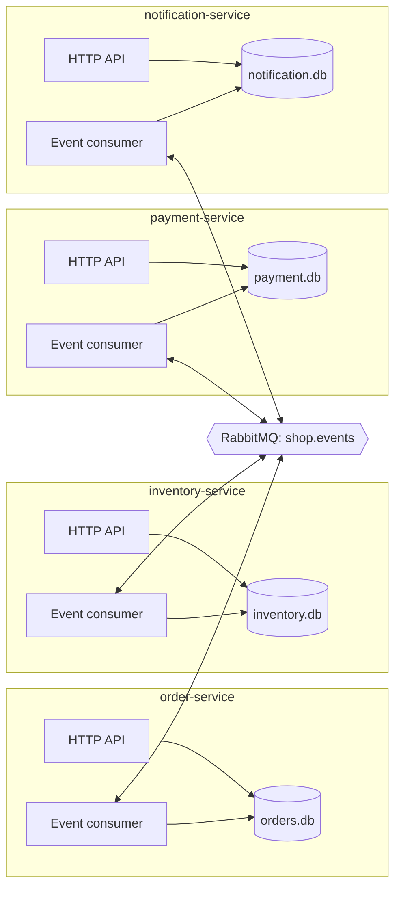
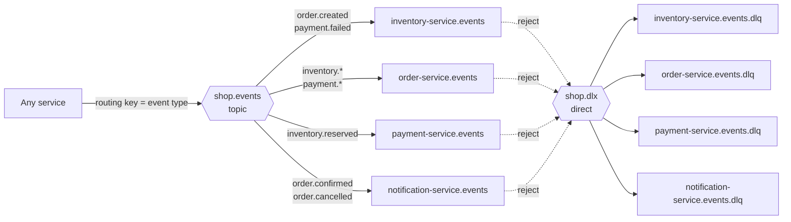
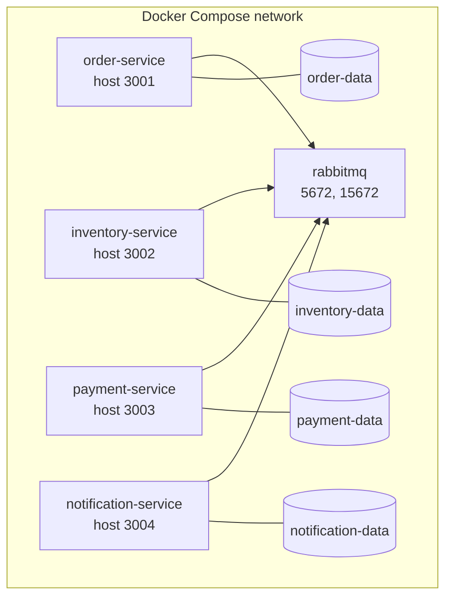

# Architecture

## Goals

- Four services with clear, single-purpose boundaries
- No shared database and no synchronous calls between services
- All inter-service communication is asynchronous events over a broker
- A multi-step business transaction (placing an order) that stays consistent without distributed locks

## System context

The gateway and the notification channel are stubs in this repository. They are the seams where real integrations would plug in.

## Containers

Every service has the same shape: a small HTTP API for commands and queries, an event consumer for reacting to other services, and a private database.

## Messaging topology

All events are published to one durable **topic exchange**, `shop.events`, using the event type as the routing key. Each service owns one durable queue and binds it to the routing keys it cares about. A failed message is rejected without requeue and lands in that queue's dead-letter queue via the `shop.dlx` exchange.

## Design principles

| Principle | How it shows up |
|---|---|
| Database per service | Each service has its own SQLite file; no cross-service reads |
| Choreography over orchestration | There is no central coordinator; each service reacts to events and emits new ones ([ADR-002](decisions.md#adr-002-choreographed-saga-instead-of-an-orchestrator)) |
| Loose coupling | Producers do not know who consumes their events; adding a consumer needs no producer change |
| At-least-once delivery, idempotent handling | Consumers record processed event ids so a redelivery is harmless ([Reliability](reliability.md)) |
| Compensating transactions | A failed payment releases the reserved stock instead of rolling back a distributed transaction |
| Traceability | Every event carries a `correlationId` equal to the order id, and each service emits structured JSON logs |
| Stateless processes | State lives in the service database and the broker, so a service can be restarted or scaled |

## Shared library

`libs/common` holds only infrastructure that every service needs: the event envelope, the RabbitMQ and in-memory bus implementations, the idempotency wrapper, HTTP scaffolding and process bootstrap. It contains no business logic. Business rules stay inside the owning service.

The in-memory bus implements the same `publish` / `subscribe` contract as the RabbitMQ bus, which is what lets the saga be tested end to end in a single process.

## Deployment view

Services wait for the broker healthcheck and also retry the broker connection on startup, so start order does not matter.
