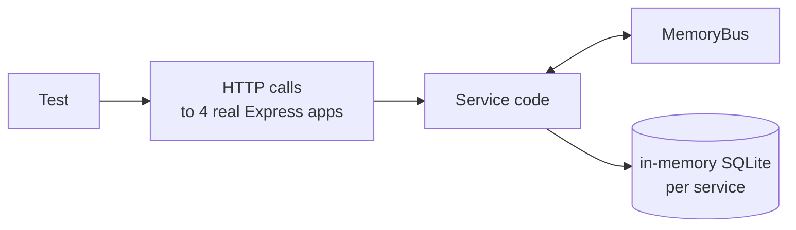

# Development guide

## Prerequisites

- Node.js 22.13 or newer (uses the built-in `node:sqlite` module and test runner)
- Docker, for the full stack
- A RabbitMQ instance, only if you run services outside Docker

## Commands

| Task | Command |
|---|---|
| Install | `npm install` |
| Run all tests | `npm test` |
| Start the full stack | `docker compose up --build` |
| Stop and delete data | `docker compose down -v` |
| Start only the broker | `docker compose up rabbitmq` |

## Configuration

| Variable | Default | Meaning |
|---|---|---|
| `PORT` | `3000` | HTTP port |
| `RABBITMQ_URL` | `amqp://localhost` | Broker connection string |
| `DB_FILE` | `:memory:` | SQLite file path. In memory means data is lost on restart |

## Running services locally

```bash
docker compose up rabbitmq -d

RABBITMQ_URL=amqp://localhost PORT=3001 DB_FILE=data/order.db     node services/order-service/src/index.js
RABBITMQ_URL=amqp://localhost PORT=3002 DB_FILE=data/inventory.db node services/inventory-service/src/index.js
RABBITMQ_URL=amqp://localhost PORT=3003 DB_FILE=data/payment.db   node services/payment-service/src/index.js
RABBITMQ_URL=amqp://localhost PORT=3004 DB_FILE=data/notification.db node services/notification-service/src/index.js
```

## Testing strategy



The end-to-end tests in `test/e2e.test.js` start all four services in one process, each with its own in-memory database, connected by the `MemoryBus`. The tests drive the system only through HTTP and assert on final state, so they exercise the same code paths as production, minus the network broker.

`bus.idle()` waits for every in-flight event, including cascading ones, which removes any need for sleeps in tests.

Covered scenarios: success, correlation ids and event order, out of stock, unknown SKU, declined card with compensation, over-limit payment, duplicate delivery, input validation and health endpoints.

## Anatomy of a service

```
services/<name>-service/
  package.json
  src/
    index.js     entry point: hands the service to bootstrap()
    service.js   exports { name, schema, createService }
```

`createService({ bus, db, log })` returns `{ app, register }`. `app` is the Express app and `register()` subscribes the service's queue. Because the bus and database are injected, the same code runs against RabbitMQ in production and the memory bus in tests.

## Adding a fifth service

1. Copy an existing service folder and rename the package.
2. Define `schema` and `createService`. Subscribe with `bus.subscribe('<name>.events', [routing keys], once(db, handler))`.
3. Add it to `docker-compose.yml` and to the `COPY` list in `docker/service.Dockerfile`.
4. Document any new events in [events.md](events.md).
5. Add it to the `Object.entries` list in `test/e2e.test.js`.

No existing service needs to change to consume events that already exist.
