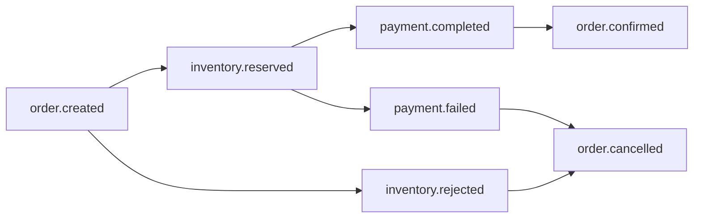

# Event catalog

## Envelope

Every message has the same envelope. The payload is in `data`.

```json
{
  "id": "6f1c8d0e-2d4b-4f0a-9a43-0d1b6f6c9a77",
  "type": "inventory.reserved",
  "occurredAt": "2026-11-11T10:15:30.123Z",
  "correlationId": "b1d2c3e4-0000-4000-8000-123456789abc",
  "data": { }
}
```

| Field | Meaning |
|---|---|
| `id` | Unique event id. Consumers use it for idempotency |
| `type` | Event name, also the RabbitMQ routing key |
| `occurredAt` | ISO-8601 UTC timestamp |
| `correlationId` | Id of the order that started the saga. Identical on every event in one flow |
| `data` | Event-specific payload (below) |

Amounts are integer **cents** to avoid floating-point errors.

## Event flow overview



## Events

### `order.created`
Published by **Order** when an order is accepted.

```json
{ "orderId": "…", "customerId": "alice", "items": [{ "sku": "SKU-MOUSE", "qty": 2 }] }
```
Consumed by: Inventory.

### `inventory.reserved`
Published by **Inventory** when every line was reserved. Carries the price, because Inventory owns the catalogue.

```json
{ "orderId": "…", "customerId": "alice", "amountCents": 5998, "items": [{ "sku": "SKU-MOUSE", "qty": 2 }] }
```
Consumed by: Payment, Order.

### `inventory.rejected`
Published by **Inventory** when nothing could be reserved (unknown sku or not enough stock).

```json
{ "orderId": "…", "customerId": "alice", "reason": "insufficient stock for SKU-LAPTOP" }
```
Consumed by: Order.

### `payment.completed`
Published by **Payment** after a successful charge.

```json
{ "orderId": "…", "customerId": "alice", "amountCents": 5998, "paymentId": "…" }
```
Consumed by: Order.

### `payment.failed`
Published by **Payment** when the charge is declined.

```json
{ "orderId": "…", "customerId": "alice", "reason": "card declined" }
```
Consumed by: Order (cancels), Inventory (releases stock).

### `order.confirmed`
Published by **Order** when payment succeeded.

```json
{ "orderId": "…", "customerId": "alice", "amountCents": 5998 }
```
Consumed by: Notification.

### `order.cancelled`
Published by **Order** when the saga failed at any step.

```json
{ "orderId": "…", "customerId": "alice", "reason": "card declined" }
```
Consumed by: Notification.

## Queue bindings

| Queue | Bound routing keys | Dead-letter queue |
|---|---|---|
| `order-service.events` | `inventory.*`, `payment.*` | `order-service.events.dlq` |
| `inventory-service.events` | `order.created`, `payment.failed` | `inventory-service.events.dlq` |
| `payment-service.events` | `inventory.reserved` | `payment-service.events.dlq` |
| `notification-service.events` | `order.confirmed`, `order.cancelled` | `notification-service.events.dlq` |

## Compatibility rules

- Adding an optional field to `data` is backwards compatible.
- Renaming or removing a field, or changing its meaning, requires a new event type (for example `order.created.v2`) published alongside the old one until all consumers move.
- Consumers must ignore fields they do not know.
