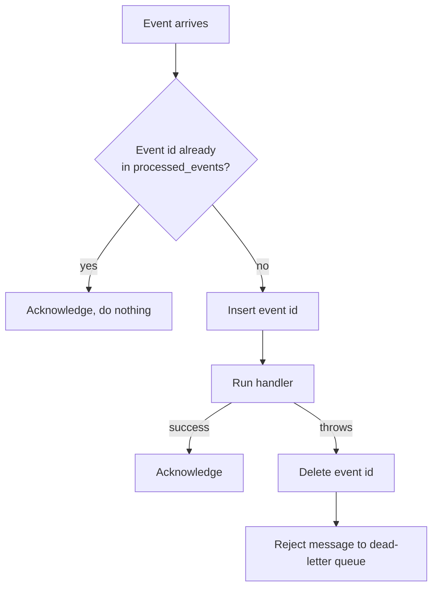
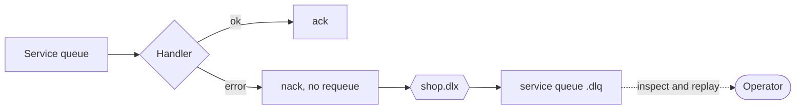

# Reliability

## Delivery guarantees

| Mechanism | Purpose |
|---|---|
| Durable exchange and queues | Survive a broker restart |
| Persistent messages | Written to disk by the broker |
| Publisher confirms | `publish` resolves only after the broker accepted the message |
| Manual acknowledgements | A message is removed from the queue only after the handler succeeds |
| Prefetch of 10 | Bounds in-flight work per consumer |

Together these give **at-least-once** delivery. A message can arrive more than once (for example, if a consumer crashes after doing the work but before acknowledging), so every consumer must be idempotent.

## Idempotent consumers

Each handler is wrapped in `once(db, handler)`:

A second layer protects against duplicates at the data level:

- Inventory: `reservations.order_id` is the primary key, and `release` only acts on a `RESERVED` row.
- Payment: `payments.order_id` is unique.
- Order: a terminal order cannot transition again, so a replayed `payment.completed` cannot publish a second `order.confirmed`.

The test suite redelivers `order.created` twice and asserts that stock is decremented exactly once.

## Failure handling

A message whose handler throws is not requeued (that would create a hot retry loop). It is parked in the service's dead-letter queue, where it can be inspected in the RabbitMQ management UI and shunted back to the main queue once the cause is fixed.

## Service outages

| Situation | Behaviour |
|---|---|
| Notification Service down | Events wait in its queue. Orders complete normally and messages go out on recovery |
| Payment Service down | Orders stay `INVENTORY_RESERVED` and resume when it returns. Stock stays reserved meanwhile |
| Inventory Service down | Orders stay `PENDING` and resume on recovery. `POST /orders` still succeeds |
| Broker down at startup | Services retry the connection every 2 seconds for up to a minute |
| Broker down at order time | `POST /orders` fails with `500` |

## Known trade-offs

These are deliberate simplifications for a reference project. Each has a standard production answer.

| Trade-off | Impact | Production remedy |
|---|---|---|
| **Dual write.** A service writes its database and then publishes. A crash between the two loses the event | An order can stay `PENDING` forever | Transactional outbox: write the event to an outbox table in the same transaction and relay it to the broker |
| **No retry with backoff.** A failed message goes straight to the DLQ | Transient errors need manual replay | Delay queues with a bounded retry count before dead-lettering |
| **No timeout on stuck orders** | An order whose event was lost is never cancelled | A scheduled sweeper, or a saga timeout event |
| **Simulated payment gateway** | Payments are not real | Integrate a PSP and send an idempotency key |
| **SQLite per service** | Single writer, local file | PostgreSQL per service |
| **No authentication** | Anyone can create orders | API gateway with token validation |

## Observability

- Every log line is JSON with `service`, `level`, `msg` and context fields.
- Every published event logs its `type`, `id` and `correlationId`. Filter all services' logs by the order id to follow one saga end to end.
- `GET /health` on each service for liveness probes.
- The RabbitMQ management UI shows queue depth, rates and dead-lettered messages.
