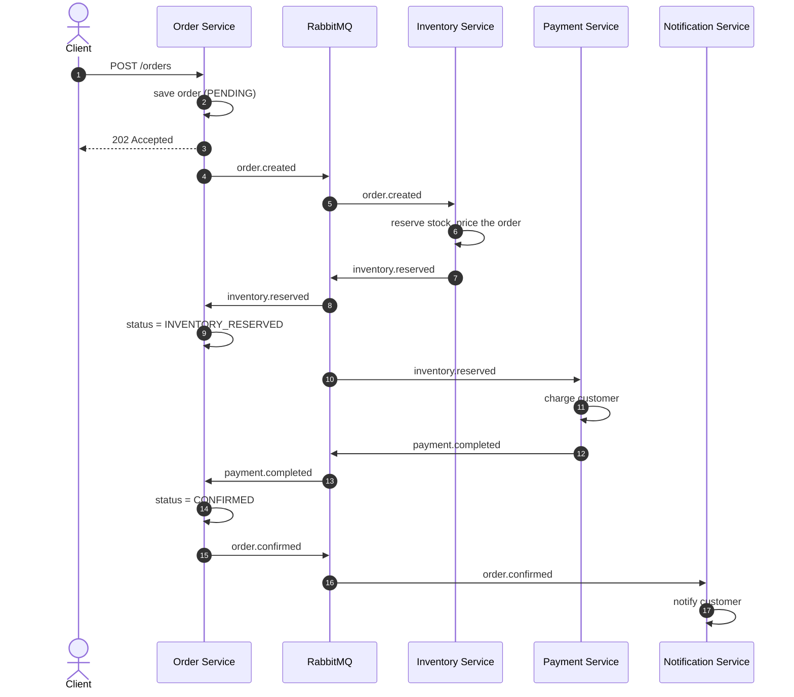
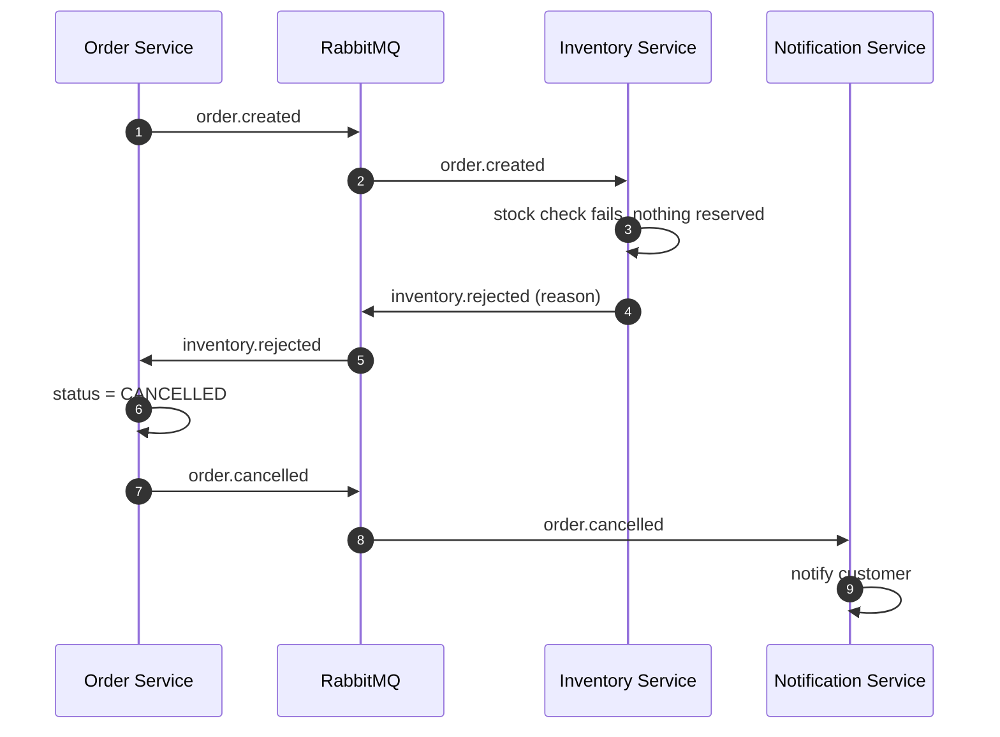
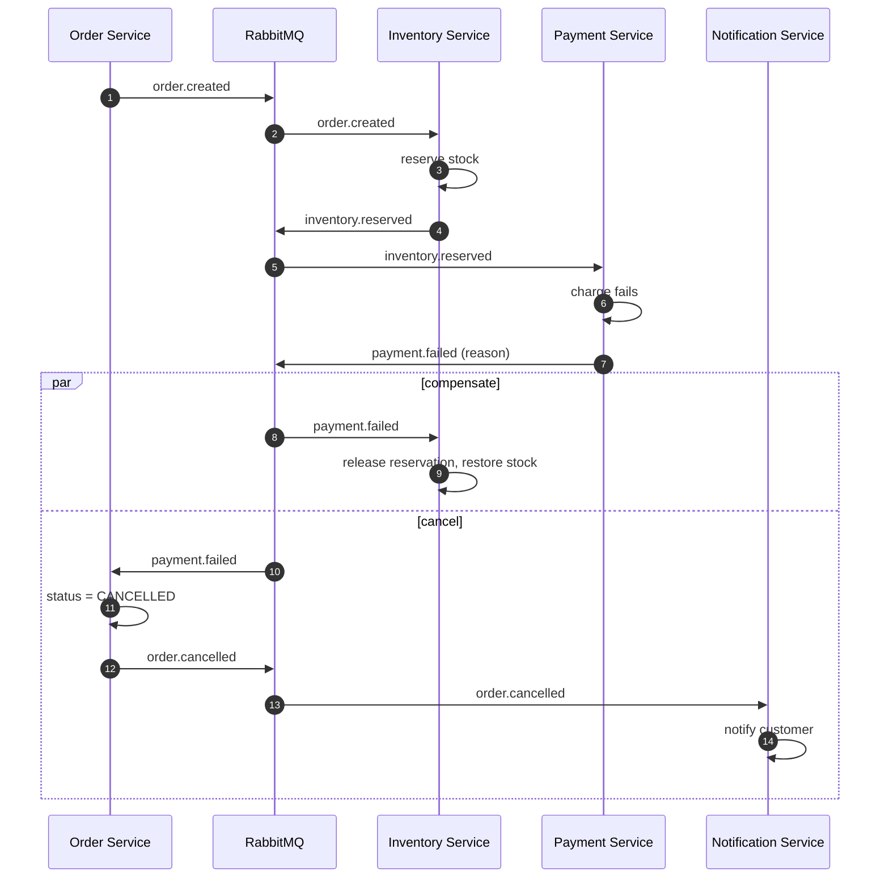
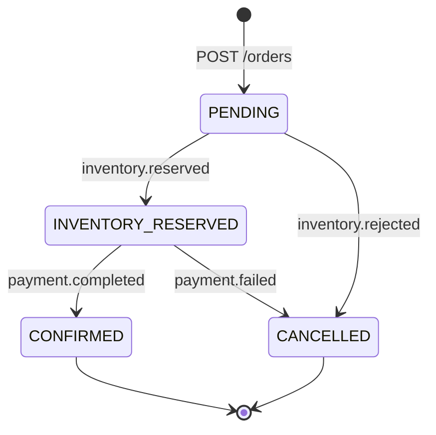
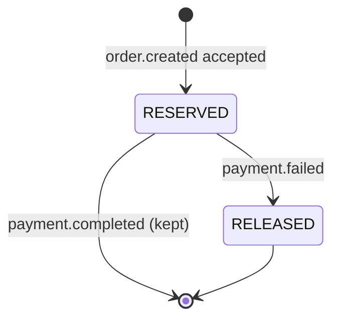

# Saga flows

Placing an order is a **choreographed saga**: a chain of local transactions, one per service, linked by events. If a step fails, earlier steps are undone with compensating actions.

## Happy path

The client gets `202 Accepted` immediately and polls `GET /orders/{id}` for the final status. The order is never blocked on downstream services.

## Failure: out of stock

Payment is never attempted, so there is nothing to compensate.

## Failure: payment declined (compensation)

`payment.failed` fans out to two consumers: Inventory undoes its reservation, and Order cancels the order. Neither depends on the other.

## Order state machine

`CONFIRMED` and `CANCELLED` are terminal. The Order Service refuses any further transition out of them, so duplicate or late events cannot reopen a finished order.

## Reservation state machine (Inventory)

## Demo scenarios

| Scenario | Request | Result |
|---|---|---|
| Success | `customerId: alice`, `SKU-MOUSE` x2 | `CONFIRMED` |
| Out of stock | `SKU-LAPTOP` x99 | `CANCELLED`: insufficient stock |
| Unknown product | `SKU-NOPE` | `CANCELLED`: unknown sku |
| Declined card | `customerId: declined-bob` | `CANCELLED`: card declined, stock restored |
| Over the limit | `SKU-LAPTOP` x1 (1299.00 > 1000.00 limit) | `CANCELLED`: amount exceeds limit, stock restored |
