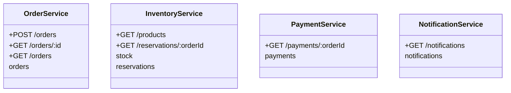

# Services

Each service is a separate npm workspace under `services/`, built from the same Dockerfile recipe, with its own database and its own queue.

## Order Service (port 3001)

**Responsibility:** the entry point for customers and the owner of the order lifecycle.

- Validates input and stores the order as `PENDING`
- Publishes `order.created`
- Moves the order through its state machine as inventory and payment events arrive
- Publishes `order.confirmed` or `order.cancelled` when the saga ends

**Data (`orders`):** `id`, `customer_id`, `items` (JSON), `status`, `total_cents`, `reason`, `created_at`, `updated_at`.

**Rules**
- A terminal order (`CONFIRMED`, `CANCELLED`) never changes again.
- The total comes from `inventory.reserved`. The client cannot set a price.

## Inventory Service (port 3002)

**Responsibility:** the product catalogue and stock levels.

- On `order.created`, reserves every line **atomically** inside one transaction. Either all lines are reserved or none are.
- Computes the order amount from catalogue prices.
- On `payment.failed`, releases the reservation (the compensating action).
- Seeds a demo catalogue on first start.

**Data:** `stock` (`sku`, `name`, `price_cents`, `available`, with `available >= 0` enforced by the database) and `reservations` (`order_id`, `items`, `status` of `RESERVED` or `RELEASED`).

**Demo catalogue**

| SKU | Product | Price | Stock |
|---|---|---|---|
| `SKU-KEYBOARD` | Mechanical keyboard | 79.99 | 50 |
| `SKU-MOUSE` | Wireless mouse | 29.99 | 100 |
| `SKU-MONITOR` | 27" monitor | 249.99 | 10 |
| `SKU-LAPTOP` | Workstation laptop | 1299.00 | 3 |

Repeated lines for the same SKU are merged before checking stock.

## Payment Service (port 3003)

**Responsibility:** charging the customer.

- On `inventory.reserved`, calls a simulated gateway and records the outcome.
- Publishes `payment.completed` or `payment.failed`.

**Simulated gateway rules** (deterministic, so failures are easy to reproduce):

| Condition | Result |
|---|---|
| `customerId` starts with `declined-` | `card declined` |
| Amount above 1000.00 (100000 cents) | `amount exceeds limit` |
| Anything else | Success |

**Data (`payments`):** `id`, `order_id` (unique, so one payment per order), `customer_id`, `amount_cents`, `status`, `reason`, `created_at`.

## Notification Service (port 3004)

**Responsibility:** telling customers the final outcome.

- On `order.confirmed` and `order.cancelled`, builds a message and stores it.
- Logs the message where a real system would call an email, SMS or push provider.
- Publishes nothing, so it can be stopped for maintenance without affecting orders. Messages queue up and are delivered when it returns.

**Data (`notifications`):** `id`, `order_id`, `customer_id`, `kind`, `message`, `created_at`.

## Common to all services

- `GET /health` for liveness checks
- Structured JSON logs with the service name
- Configuration only through environment variables: `PORT`, `RABBITMQ_URL`, `DB_FILE`
- A `processed_events` table used for idempotent event handling
- Graceful shutdown on `SIGTERM` and `SIGINT`
